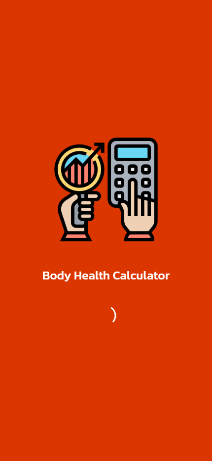

# Body ว้าว

**Body ว้าว (Body Health Calculator)** คือแอปคำนวณดัชนีมวลกาย (BMI) และอัตราการเผาผลาญพื้นฐาน (BMR) พัฒนาด้วย Flutter และ Dart เพื่อฝึกออกแบบแบบฟอร์ม ตรวจสอบข้อมูล และแสดงผลคำนวณในแอปเดียว ผู้ใช้สลับระหว่างหน้าคำนวณและหน้า About ได้จากแถบนำทางด้านล่าง

## ฟังก์ชันการทำงาน

- เปิดหน้า About หลัง Splash 3 วินาที และสลับแท็บ BMI, About และ BMR จากแถบนำทางด้านล่าง
- **BMI** คำนวณจากน้ำหนัก (กก.) ÷ ส่วนสูง (ม.)² โดยแปลงส่วนสูงจากเซนติเมตรเป็นเมตรก่อนคำนวณ ใช้ค่าก่อนปัดเศษแปลผลตามจุดแบ่ง 18.5, 23, 25 และ 30 เป็นน้ำหนักต่ำกว่าเกณฑ์ น้ำหนักสมส่วน น้ำหนักเกิน โรคอ้วนระดับ 1 และโรคอ้วนระดับ 2 หรืออ้วนมาก ตามลำดับ
- **BMR** ใช้น้ำหนัก (กก.) ส่วนสูง (ซม.) และอายุเต็มปี ผลลัพธ์มีหน่วย `kcal/day`
  - ชาย · 88.362 + (13.397 × น้ำหนัก) + (4.799 × ส่วนสูง) − (5.677 × อายุ)
  - หญิง · 447.593 + (9.247 × น้ำหนัก) + (3.098 × ส่วนสูง) − (4.330 × อายุ)
- ทั้งสองหน้าตรวจข้อมูลก่อนคำนวณ รับเฉพาะตัวเลขบวก และรับจุดทศนิยมสำหรับน้ำหนักและส่วนสูง ผลแสดงสองตำแหน่ง ปุ่ม **ล้างข้อมูล** คืนค่าเริ่มต้น และ BMR กลับไปเลือกชาย

## ภาพหน้าจอแอปพลิเคชัน

ภาพจากแอปที่รันใน Chrome แบบเบื้องหลังที่ขนาด 430 × 932 logical pixels ตามขนาดอ้างอิง iPhone 15 Pro Max
ตัวเลขในภาพเป็นข้อมูลสังเคราะห์
ภาพ About และผล BMR เป็นภาพหลังแก้ตาม Independent Review โดย About ใช้ข้อความและเครดิตจากเลเยอร์ `image 2` และผล BMR ใช้การ์ดสีเขียวอ่อนมุมเหลี่ยมแบบเดียวกับ BMI

| Splash | Home / About | BMI |
| :---: | :---: | :---: |
|  |  |  |

| ผล BMI | BMR | ผล BMR |
| :---: | :---: | :---: |
|  |  |  |

## เทคโนโลยีที่ใช้

| เทคโนโลยี / แพ็กเกจ | หน้าที่ |
|---|---|
| Flutter 3.50.0 และ Dart 3.14.0 | สร้างหน้าจอ จัดการข้อมูล และคำนวณผล เวอร์ชันตามสภาพแวดล้อมที่ใช้ทดสอบ |
| `material_ui` 1.11.1 | องค์ประกอบ Material UI |
| `font_awesome_flutter` 11.0.0 | ไอคอน BMR |
| Kanit | ฟอนต์ของแอป |

## โครงสร้างโปรเจกต์

| ไฟล์หรือโฟลเดอร์ | Class / ข้อมูล | หน้าที่ |
|---|---|---|
| `lib/main.dart` | จุดเริ่มต้น | ตั้งค่าแอปและเปิด Splash |
| `lib/views/splash_screen_ui.dart` | `SplashScreenUI` | แสดงภาพเปิดแอปก่อนเข้าสู่ Home |
| `lib/views/home_ui.dart` | `HomeUI` | จัดการแถบนำทางและแท็บที่เลือก |
| `lib/views/bmi_ui.dart` | `BmiUI` | แบบฟอร์มและผล BMI |
| `lib/views/bmr_ui.dart` | `BmrUI` | แบบฟอร์มและผล BMR |
| `lib/views/about_ui.dart` | `AboutUI` | ข้อมูลแอปและเครดิตตามแบบอ้างอิง |
| `lib/widgets/` | วิดเจ็ตใช้ร่วมกัน | ส่วนประกอบแบบฟอร์มและการ์ดผล |
| `assets/`, `docs/screenshots/` | รูป ฟอนต์ และภาพหน้าจอ | ทรัพยากรแอปและภาพจากการรันจริง |
| `test/widget_test.dart` | Widget Tests | ตรวจการนำทาง สูตร และการกรอกข้อมูล |
| `android/`, `ios/`, `web/` | โครงสร้างแพลตฟอร์ม | ไฟล์ตั้งค่าของแต่ละแพลตฟอร์ม |

## การติดตั้งและใช้งาน

เปิด Terminal ที่โฟลเดอร์โปรเจกต์ด้วย Flutter 3.50 และ Dart 3.14 แล้วรัน

```sh
flutter pub get
flutter run -d chrome
```

ใช้ Device Toolbar ใน Chrome DevTools แล้วตั้ง viewport เป็น 430 × 932 เพื่อตรวจเทียบกับ mockups
หรือเลื่อนไปด้านล่างของแบบกรอกเพื่อดูผล BMR บนหน้าจอเตี้ย

## การทดสอบและข้อจำกัด

ผลจากการตรวจรับทางเทคนิคเมื่อ 26 พฤศจิกายน 2569 หลังแก้ About และการ์ดผล BMR

| การตรวจ | ผล |
|---|---|
| `flutter analyze` | ผ่าน |
| `flutter test` | ผ่าน 44/44 |
| `flutter build web --no-web-resources-cdn` | ผ่าน และตรวจหน้าจอใน Chrome |
| `flutter build apk --debug` | สร้าง Android Debug APK สำเร็จ ยังไม่ได้ยืนยันการติดตั้งหรือรันฉบับหลังแก้บนอุปกรณ์หรือ Emulator |
| iOS | ยังไม่ได้ Build หรือทดสอบบนอุปกรณ์หรือ Simulator ภาพตามขนาด iPhone 15 Pro Max มาจาก Chrome |

## เครดิตและสิทธิ์การใช้งาน

- **ทรัพยากรจากอาจารย์และ Figma** เมื่อวันที่ 26 พฤศจิกายน 2569 อาจารย์ตอบว่า “จัดได้เลย” เมื่อผู้เรียนถามเรื่องการนำรูปภาพและไอคอนจาก Figma รวมถึงไฟล์ Resources ที่อาจารย์ให้ ขึ้น Public GitHub เพื่อส่งงานในรายวิชา รูปภาพ ไอคอน ภาพแบบหน้าจอ และทรัพยากรประกอบโจทย์เป็นของเจ้าของเดิม เงื่อนไขลิขสิทธิ์และเครื่องหมายการค้าของบุคคลที่สามยังมีผล
- **ฟอนต์และแพ็กเกจ** ฟอนต์ Kanit โดย The Kanit Project Authors มาจาก [Google Fonts](https://github.com/google/fonts/tree/main/ofl/kanit) และบรรจุพร้อม [SIL Open Font License 1.1](assets/fonts/Kanit-OFL.txt) ไอคอน BMR ใช้ Font Awesome Free โดย Fonticons, Inc. ผ่าน `font_awesome_flutter` ซึ่งมีลิขสิทธิ์ของ Brian Egan และ Michael Spiss ภายใต้ MIT License ส่วน Font Awesome Free ใช้ SIL OFL 1.1 สำหรับไฟล์ฟอนต์ และ CC BY 4.0 สำหรับไอคอนที่แจกจ่ายในรูปแบบ SVG หรือ JS [สัญญาอนุญาตของแพ็กเกจ](https://pub.dev/packages/font_awesome_flutter/license) · [Font Awesome Free License](https://fontawesome.com/license/free)
- **ทรัพยากรบุคคลที่สามและเครื่องหมายการค้า** ตราสัญลักษณ์ SAU เป็นของมหาวิทยาลัยเอเชียอาคเนย์และเป็นทรัพยากรที่อาจารย์ให้เพื่อใช้ในหน้า About ของโครงการฝึกพัฒนาในรายวิชา ยังไม่มีหลักฐานจากเจ้าของตราโดยตรงที่ยืนยันสิทธิ์เผยแพร่ไฟล์ตราและภาพหน้าจอที่แสดงตราบน GitHub สาธารณะ [ข้อมูลตราสัญลักษณ์จากมหาวิทยาลัย](https://www.sau.ac.th/th/symbol.html)
