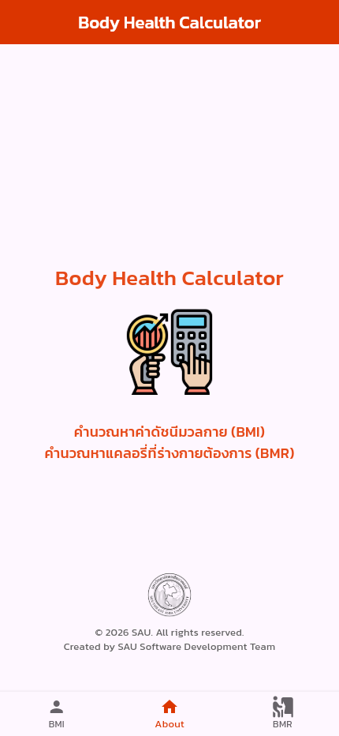
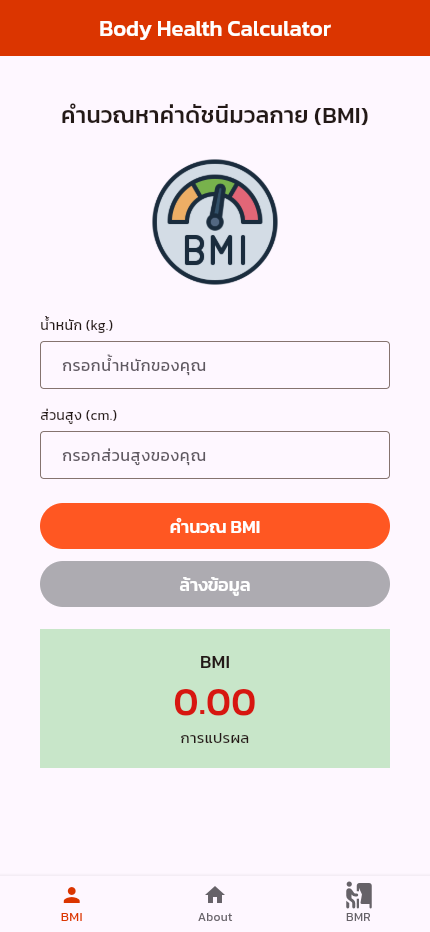
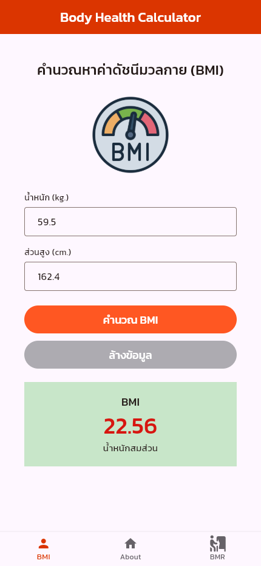
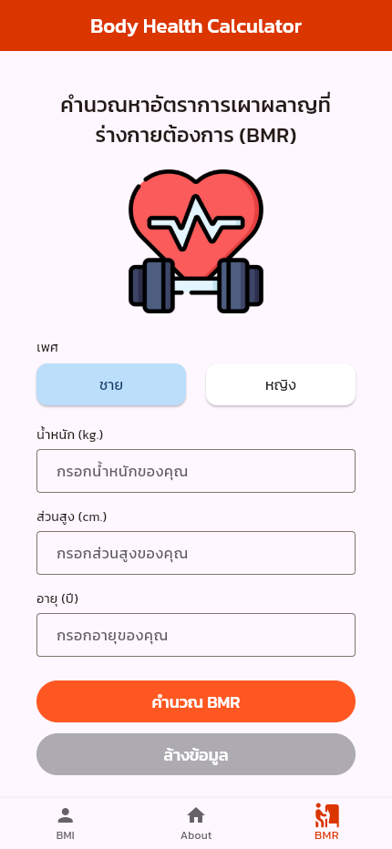
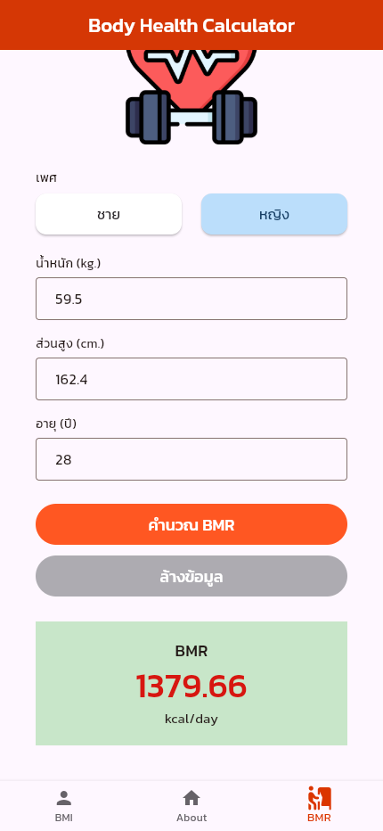

# Body ว้าว

Body ว้าวเป็นแอปคำนวณดัชนีมวลกาย (BMI) และอัตราการเผาผลาญพื้นฐาน (BMR) ด้วย Flutter และ Dart ผู้ใช้กรอกข้อมูลและดูผลได้จากแท็บ BMI หรือ BMR

## ฟังก์ชันการทำงาน

- เปิดหน้า About หลังหน้าเปิดแอป 3 วินาที แล้วสลับแท็บ BMI, About และ BMR จากแถบด้านล่าง
- ตรวจข้อมูลที่กรอก แสดงผลคำนวณสองตำแหน่ง และล้างข้อมูลกลับค่าเริ่มต้นได้ โดยหน้า BMR กลับไปเลือกชาย

### สูตรและเกณฑ์แปลผล

BMI (กก./ม.²) = น้ำหนัก (กก.) ÷ ส่วนสูง (ม.)² โดยแอปแปลงส่วนสูงจากเซนติเมตรเป็นเมตรก่อนคำนวณ และแปลผลจากค่าก่อนปัดเศษ โดยเผื่อความคลาดเคลื่อน `10⁻¹²` ที่จุดแบ่ง

| BMI (กก./ม.²) | ผลที่แสดง |
| --- | --- |
| ต่ำกว่า 18.5 | น้ำหนักต่ำกว่าเกณฑ์ |
| ตั้งแต่ 18.5 ถึงต่ำกว่า 23 | น้ำหนักสมส่วน |
| ตั้งแต่ 23 ถึงต่ำกว่า 25 | น้ำหนักเกิน |
| ตั้งแต่ 25 ถึงต่ำกว่า 30 | โรคอ้วนระดับ 1 |
| ตั้งแต่ 30 ขึ้นไป | โรคอ้วนระดับ 2 หรืออ้วนมาก |

BMR มีหน่วยกิโลแคลอรีต่อวัน (`kcal/day`) คำนวณจากน้ำหนัก (กก.) ส่วนสูง (ซม.) และอายุ (ปี)

- ชาย · `88.362 + (13.397 × น้ำหนัก) + (4.799 × ส่วนสูง) − (5.677 × อายุ)`
- หญิง · `447.593 + (9.247 × น้ำหนัก) + (3.098 × ส่วนสูง) − (4.330 × อายุ)`

น้ำหนักและส่วนสูงต้องเป็นตัวเลขบวกและกรอกเป็นทศนิยมได้ อายุเป็นจำนวนเต็มบวก แอปจะแจ้งเตือนหากผลคำนวณไม่อยู่ในช่วงที่มากกว่า 0 และน้อยกว่า 10²¹

## ภาพหน้าจอแอปพลิเคชัน

ภาพจาก Flutter Web ใน Chrome ขนาด 430 × 932 logical pixels ตามขนาดอ้างอิง iPhone 15 Pro Max ตัวเลขในภาพเป็นข้อมูลสังเคราะห์

| Splash | Home / About | BMI |
| :---: | :---: | :---: |
|  |  |  |

| ผล BMI | BMR | ผล BMR |
| :---: | :---: | :---: |
|  |  |  |

## เทคโนโลยีที่ใช้

| เทคโนโลยี / แพ็กเกจ | หน้าที่ |
|---|---|
| Flutter 3.50.0 และ Dart 3.14.0 | สร้างหน้าจอ จัดการข้อมูล และคำนวณผล เวอร์ชันตามสภาพแวดล้อมที่ใช้ทดสอบ |
| `material_ui` 1.11.1 | องค์ประกอบ Material UI |
| `font_awesome_flutter` 11.0.0 | ไอคอน BMR |
| Kanit | ฟอนต์ของแอป |

## โครงสร้างโปรเจกต์

| ไฟล์ | Class | หน้าที่ |
|---|---|---|
| `lib/main.dart` | `FlutterBodyHealthCalculatorProject` | ตั้งค่าแอปและเปิด Splash |
| `lib/views/splash_screen_ui.dart` | `SplashScreenUI` | แสดงภาพเปิดแอปก่อนเข้าสู่ Home |
| `lib/views/home_ui.dart` | `HomeUI` | จัดการแถบนำทางและแท็บที่เลือก |
| `lib/views/bmi_ui.dart` | `BmiUI` | แบบฟอร์มและผล BMI |
| `lib/views/bmr_ui.dart` | `BmrUI` | แบบฟอร์มและผล BMR |
| `lib/views/about_ui.dart` | `AboutUI` | ข้อมูลแอปและเครดิตตามแบบอ้างอิง |
| `lib/widgets/calculator_widgets.dart` | `CalculatorLayout`, `CalculatorField`, `CalculatorButtons`, `CalculatorResult` | ส่วนประกอบแบบฟอร์มและการ์ดผล |
| `assets/`, `docs/screenshots/` | — | ทรัพยากรแอปและภาพจากการรันจริง |
| `test/widget_test.dart` | — | ตรวจการนำทาง สูตร และการกรอกข้อมูล |
| `android/`, `ios/`, `web/` | — | ไฟล์ตั้งค่าของแต่ละแพลตฟอร์ม |

## การติดตั้งและใช้งาน

ใช้ Flutter SDK ที่รองรับ Dart `^3.14.0` ตาม `pubspec.yaml` เวอร์ชันที่ใช้ทดสอบคือ Flutter 3.50.0 ติดตั้ง Chrome แล้วรันคำสั่งจากโฟลเดอร์โปรเจกต์

```sh
flutter pub get
flutter run -d chrome
```

เลือกแท็บ BMI หรือ BMR แล้วกรอกข้อมูลและกดคำนวณ บนหน้าจอเตี้ยให้เลื่อนลงเพื่อดูผล BMR

## การทดสอบและข้อจำกัด

| รายการ | ผล |
| --- | --- |
| `flutter analyze` | ผ่าน |
| `flutter test` | ผ่าน 44/44 |
| Web build | สร้างสำเร็จ |
| Web runtime | ตรวจหน้าจอใน Chrome |
| Android build | สร้าง debug APK สำเร็จ |
| Android runtime | ยังไม่ได้ยืนยันการติดตั้งหรือรัน APK บน Emulator หรืออุปกรณ์จริง |
| iOS | ยังไม่ได้ Build หรือทดสอบบน Simulator หรืออุปกรณ์จริง |

## เครดิตและสิทธิ์การใช้งาน

### ทรัพยากรจากอาจารย์และ Figma

หน้าจออ้างอิงแบบ Figma และใช้ภาพกับไอคอนจากทรัพยากรที่อาจารย์จัดเตรียมให้สำหรับรายวิชา

### ฟอนต์ แพ็กเกจ และสัญญาอนุญาตโอเพนซอร์ส

ฟอนต์ Kanit โดย The Kanit Project Authors มาจาก [Google Fonts](https://github.com/google/fonts/tree/main/ofl/kanit) และบรรจุพร้อม [SIL Open Font License 1.1](assets/fonts/Kanit-OFL.txt) ไอคอน BMR ใช้ Font Awesome Free โดย Fonticons, Inc. ผ่าน `font_awesome_flutter` ซึ่งมีลิขสิทธิ์ของ Brian Egan และ Michael Spiss ภายใต้ MIT License ส่วน Font Awesome Free ใช้ SIL OFL 1.1 สำหรับไฟล์ฟอนต์ และ CC BY 4.0 สำหรับไอคอนที่แจกจ่ายในรูปแบบ SVG หรือ JS [สัญญาอนุญาตของแพ็กเกจ](https://pub.dev/packages/font_awesome_flutter/license) · [Font Awesome Free License](https://fontawesome.com/license/free)

### ทรัพยากรและเครื่องหมายการค้าของบุคคลที่สาม

ตราสัญลักษณ์ SAU เป็นของมหาวิทยาลัยเอเชียอาคเนย์และเป็นทรัพยากรที่อาจารย์ให้เพื่อใช้ในหน้า About ของโครงการฝึกพัฒนาในรายวิชา ยังไม่มีหลักฐานจากเจ้าของตราโดยตรงที่ยืนยันสิทธิ์เผยแพร่ไฟล์ตราและภาพหน้าจอที่แสดงตราบน GitHub สาธารณะ [ข้อมูลตราสัญลักษณ์จากมหาวิทยาลัย](https://www.sau.ac.th/th/symbol.html)
